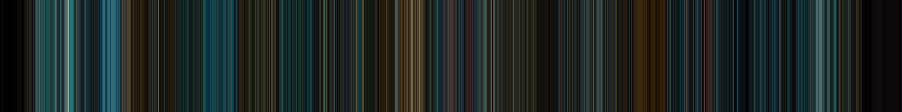

# MBA
MBA or **Movie Barcode API**, allows you to obtain movie barcode color data or customizable renders on-demand.

An online tool is available to produce rendered images here: [https://mba.wissens.space/source/list](https://mba.wissens.space/source/list).

The API is still on working development and not yet available for public use.

## What are Movie Barcodes

A movie barcode is the result of calculating the average color of each frame from a movie, then painting a strip of that color in an image placing the strips in sequence order. 

Here is one for the classic [Blade Runner (1982)](https://mba.wissens.space/source/30/render?height=500&width=4000&strip_width=20&max_strips=4000&kind=0&radius=2000&radius_inner=200&f=false) film:

